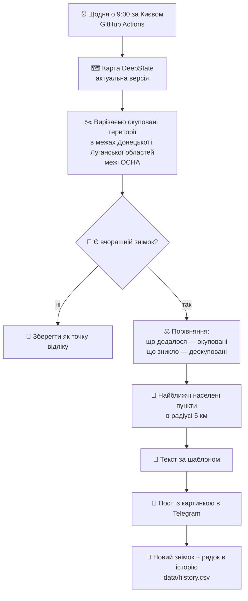

# DeepState: зміни за добу — Донеччина і Луганщина

Автоматичний щоденний моніторинг змін позначень на карті DeepState для Донецької та Луганської областей.
Без ШІ: лише розрахунки і текст за шаблоном.

**ГО «Антикризовий медіа-центр»** — незалежне регіональне медіа про Донеччину з 2015 року. Розповідаємо про події та людей регіону – де б вони не були. Входимо до Мапи рекомендованих медіа.
Суб'єкт у сфері медіа, ідентифікатор: R40-06163. Сайт: https://acmc.ua

## Як це працює

## Що де лежить

| Файл / папка | Що це |
|---|---|
| `tracker.py` | Увесь алгоритм. Налаштування — у блоці `CONFIG` на початку |
| `.github/workflows/daily.yml` | Розклад і запуск |
| `assets/cover.jpg` | Картинка до поста (поклади сюди свою) |
| `data/state/` | Останній знімок карти (для порівняння) |
| `data/history.csv` | Історія по днях: площі, зміни, населені пункти — для тижневих і місячних підсумків |
| `data/changes/` | Геометрія змін за кожен день, коли вони були |
| `data/reference/` | Межі областей і населені пункти (завантажуються один раз) |

## Налаштування (один раз)

1. **Створи репозиторій** на github.com → New repository → назва, наприклад, `deepstate-tracker` → Create.
2. **Завантаж файли**: Add file → Upload files → перетягни вміст цієї папки (разом із папкою `.github`) → Commit.
   Папку `.github` браузер може не показати, бо вона прихована. Тоді створи файл вручну: Add file → Create new file → назва `.github/workflows/daily.yml` → встав вміст.
3. **Картинка**: завантаж обкладинку як `assets/cover.jpg`.
4. **Секрети**: Settings → Secrets and variables → Actions → New repository secret:
   - `TELEGRAM_BOT_TOKEN` — токен бота (той самий, що в Make)
   - `TELEGRAM_CHAT_ID` — ID каналу, наприклад `-100…` (без пробілів)
   - `TELEGRAM_ALERT_CHAT_ID` — *необов'язково*: твій особистий чат із ботом, сюди прийде повідомлення, якщо щось зламається
5. **Дозволи**: Settings → Actions → General → Workflow permissions → **Read and write permissions** → Save.
6. **Перший запуск**: вкладка Actions → «DeepState — зміни за добу» → Run workflow → постав галочку `force` → Run.
   Перший запуск лише збереже точку відліку. Перший пост буде наступного дня о 9:00.

## Ручний запуск і тест

Actions → Run workflow:
- `force` — запустити зараз, незалежно від часу;
- `dry_run` — порахувати, але не надсилати в Telegram (текст видно в журналі запуску).

## Надійність

- Якщо DeepState або інше джерело тимчасово недоступне, скрипт робить кілька спроб. Якщо не вийшло, GitHub надішле тобі лист, а бот — повідомлення в службовий чат (якщо налаштований).
- Розклад має два запуски (06:00 і 07:00 UTC), тож пост виходить о 9:00 за Києвом і взимку, і влітку. Зайвий запуск пропускається, повторних постів не буває.
- Якщо Telegram не прийняв пост, наступний запуск того ж дня спробує ще раз.
- Дрібні «зміни» до 0,01 км² відкидаються: це шум від перемальовування меж.
- Щоденні збереження даних не дають GitHub вимкнути розклад через неактивність.
